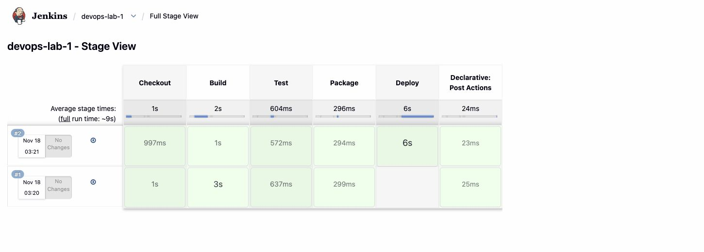

# devops-lab-1

Rishav | Roll no. 2301730245

DevOps and Automation — Lab 1: Git, GitHub and Jenkins.

A small Flask app with a Jenkins pipeline that installs dependencies, runs tests,
packages the app and deploys it to an Ubuntu host.

**Run locally**

Use Python 3.12 or newer.

```bash
python3 -m venv .venv
source .venv/bin/activate
pip install -r requirements-dev.txt
python -m flask --app app.app run --port 5001
```

Open `http://localhost:5001`. The `/health` route returns the app version and status.

```bash
python -m pytest tests/ -v
```

**Jenkins**

Create a Pipeline job, select “Pipeline script from SCM”, use this repository's
URL and set the branch to `*/main`. The script path is `Jenkinsfile`.
The agent needs Git, Python, venv, tar, curl and Docker. Install the Git, Pipeline and JUnit
plugins. The pipeline checks for changes every five minutes after its first run.

The default build deploys the tested app with Docker on port 5011. Set
`DEPLOY=false` for a build/test/package run. The SCM polling trigger uses the same
defaults, so a source change can also deploy automatically.

For an Ubuntu service host, configure the service and select
`DEPLOY_TARGET=systemd`. Setup and lab commands are in
[docs/lab-record.md](docs/lab-record.md). GitHub Actions also runs the unit tests.

**Reports and screenshots**

[Submission map](docs/submission-checklist.md)

[Question-wise PDF reports](reports/README.md) | [Run screenshots](docs/screenshots/README.md) | [Command output](docs/commands/)


