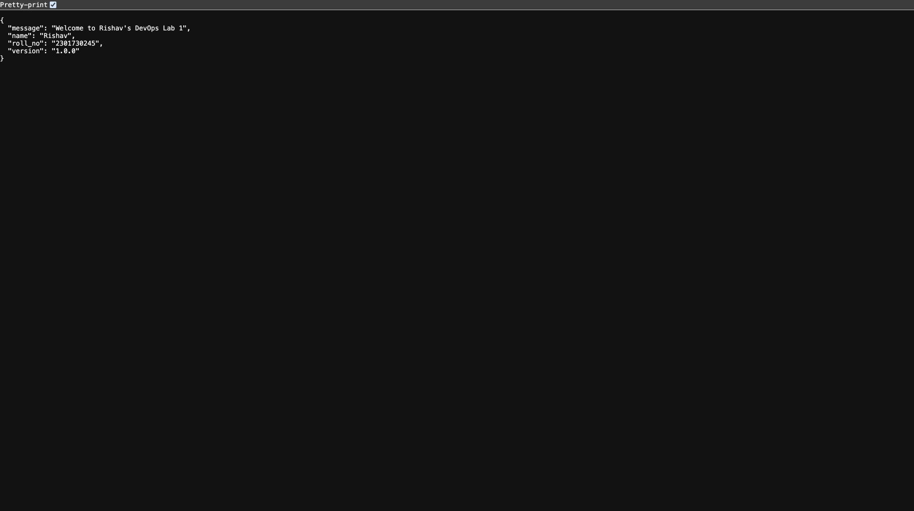
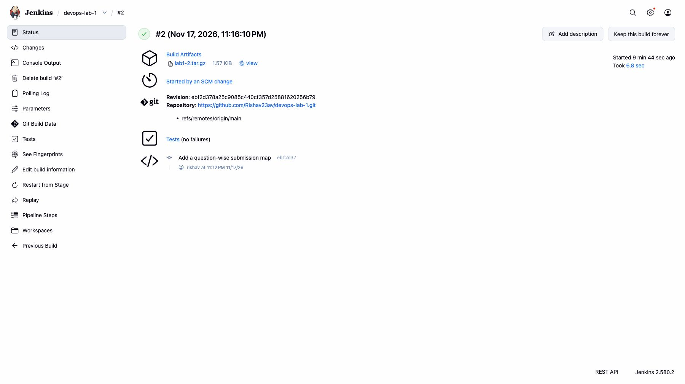
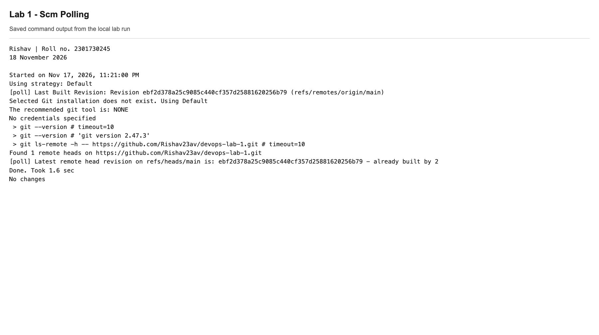
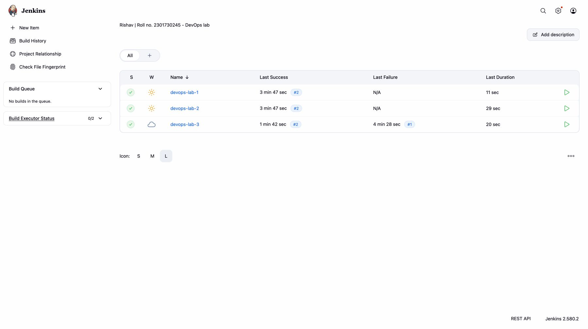
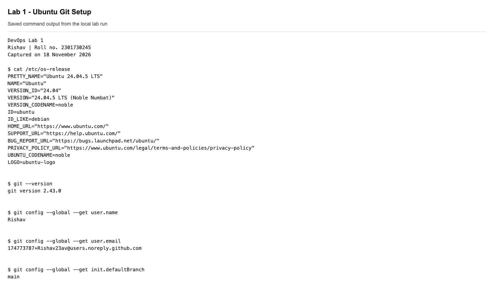
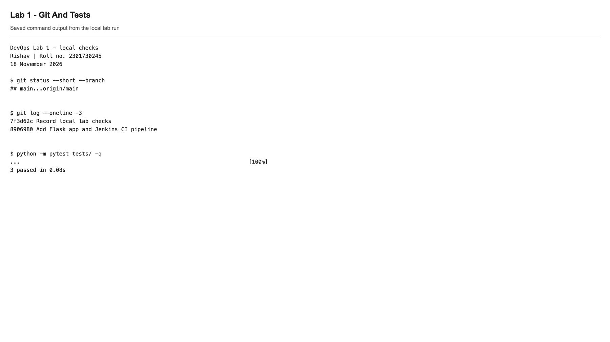
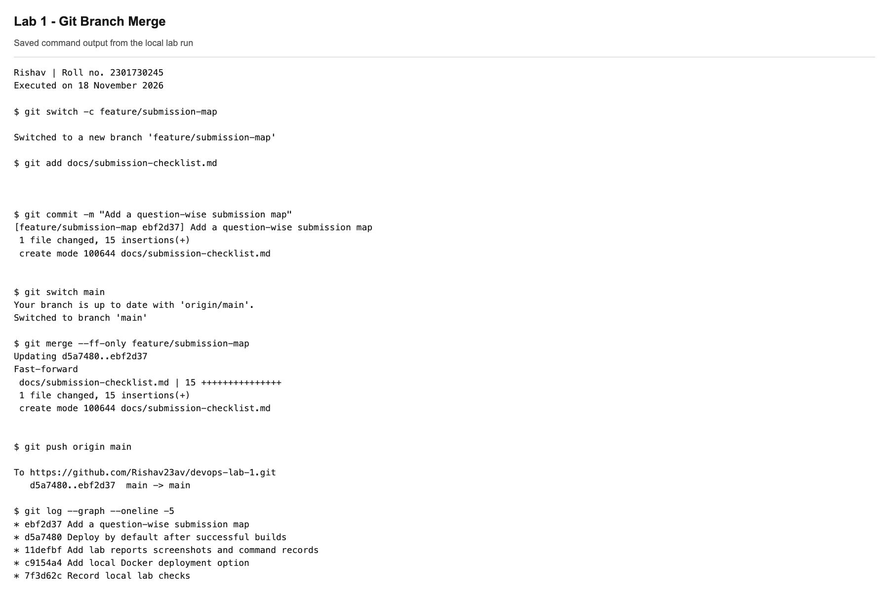
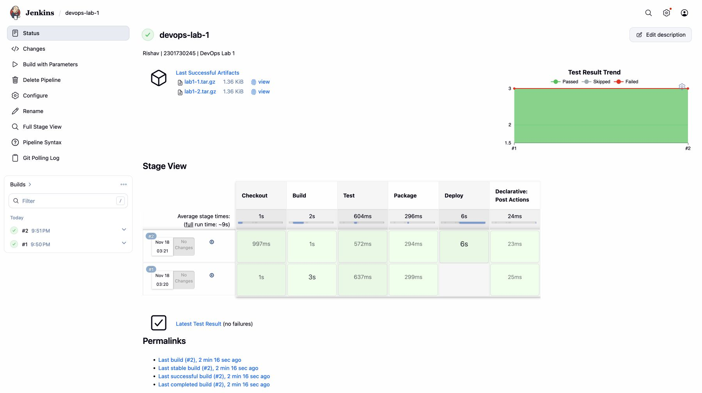
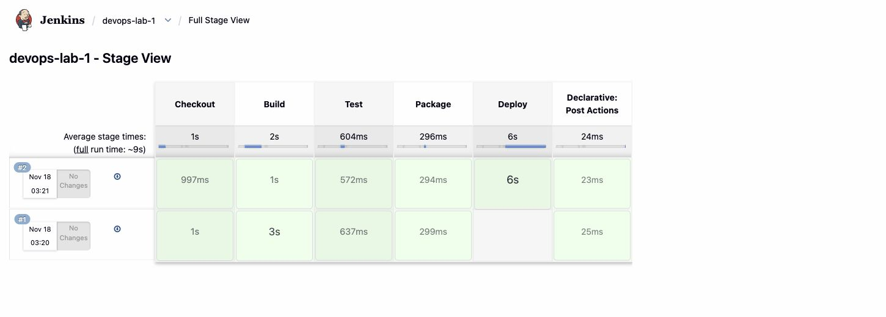

# Lab 1 screenshots

Rishav | Roll no. 2301730245

Captured from the actual local runs. Saved-command-output pages show the stdout kept in [command records](../commands/).

**q3 app response**

**q3 pipeline deployed app**

**q3 scm build**

**q3 scm trigger**

**q4 jenkins dashboard**

**q4 ubuntu git**

**q5 git and tests**

**q5 git branch merge**

**q6 jenkins job**

**q7 jenkins stages**

